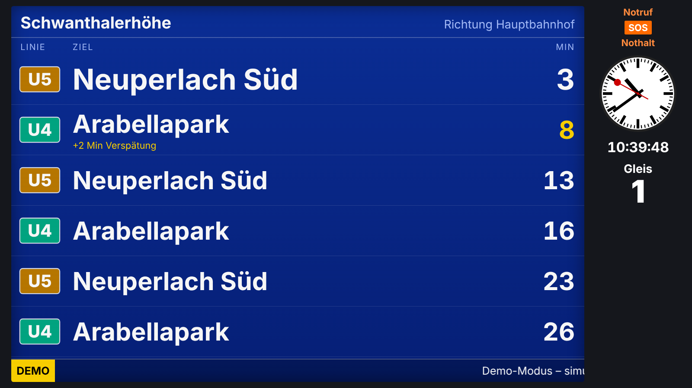

# U-Bahn Abfahrtsanzeige (Schwanthalerhöhe → Hauptbahnhof)

Eine Monitor-Anzeige im Stil der Münchner U-Bahn-Zugzielanzeiger: Echtzeit-Abfahrten
der MVG, Bahnhofsuhr, Gleis, Laufband.

## Starten

Voraussetzung: **Python 3** (https://www.python.org/downloads/ – unter Windows bei der
Installation „Add Python to PATH“ anhaken). Sonst nichts.

- **Windows:** Doppelklick auf `start-windows.bat`
- **Mac/Linux:** `./start-mac-linux.sh`
- oder manuell: `python3 server.py` und dann http://localhost:8080 im Browser öffnen

Im Browser **Doppelklick** oder Taste **F** → Vollbild. Der Mauszeiger verschwindet automatisch.
Für einen zweiten Monitor: Browserfenster auf den Monitor ziehen, dann Vollbild.

## Einstellungen (in der Adresszeile)

| Adresse | Wirkung |
|---|---|
| `http://localhost:8080` | Schwanthalerhöhe, nur Richtung Hauptbahnhof (U4 → Arabellapark, U5 → Neuperlach Süd) |
| `?richtung=alle` | beide Richtungen |
| `?station=Theresienwiese` | andere Haltestelle |
| `?zeilen=4` | Anzahl der Zeilen |
| `?demo=1` | Demo-Daten ohne Internet |

Beispiel: `http://localhost:8080/?station=Odeonsplatz&richtung=alle&zeilen=8`

Die Daten kommen alle 20 Sekunden von der (inoffiziellen, öffentlichen) MVG-Schnittstelle
`mvg.de/api/bgw-pt/v3`. `server.py` holt sie ab, weil der Browser sie nicht direkt
abfragen darf. Verspätungen werden gelb angezeigt, ausgefallene Fahrten durchgestrichen.
